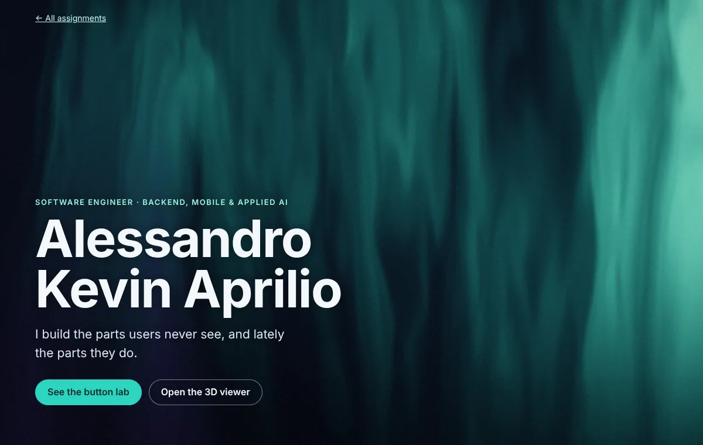
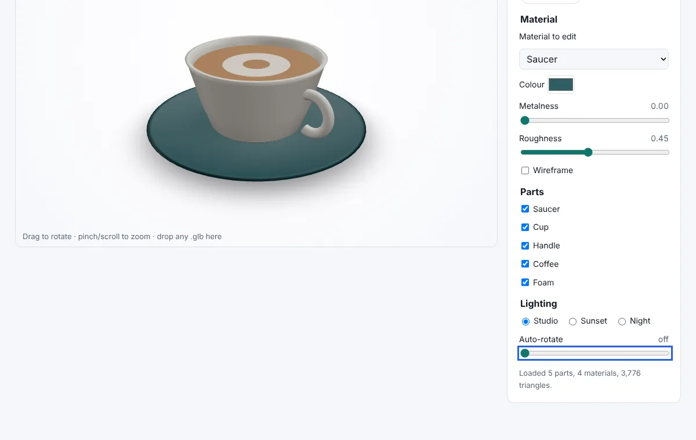
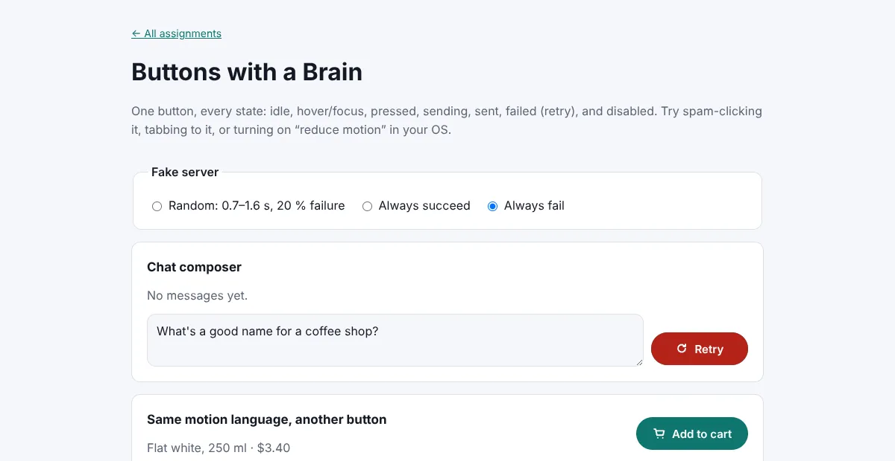
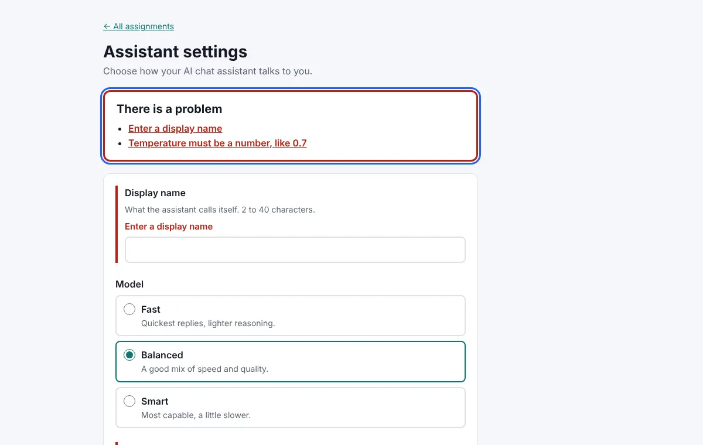

# flyrank-frontend-ai

FlyRank Front-end AI Engineering track, by **Alessandro Kevin Aprilio**. Four small, finished pieces of front-end work
live in one Vite + React 19 + TypeScript app, with one page per assignment, deployed to GitHub Pages. All of it was
built with an AI assistant (Claude); what I decided and checked myself is listed [at the end](#how-this-was-built).

**Live demo:** https://epinnn14.github.io/flyrank-frontend-ai/

| Demo | Assignment | What it shows |
|---|---|---|
| [Settings](https://epinnn14.github.io/flyrank-frontend-ai/settings/) | FE-04 · AI-assisted workflow drill | The same form built from a lazy prompt and a precise one, diffed in [WORKFLOW.md](WORKFLOW.md) |
| [Buttons](https://epinnn14.github.io/flyrank-frontend-ai/buttons/) | FE-AA1 · Buttons with a Brain | A 5-state button with interruptible motion, keyboard focus, reduced motion |
| [3D Viewer](https://epinnn14.github.io/flyrank-frontend-ai/viewer/) | FE-AA2 · First 3D Experience | three.js + React Three Fiber, drag-and-drop GLB, a configurator, a lazy chunk, a poster fallback |
| [Hero](https://epinnn14.github.io/flyrank-frontend-ai/hero/) | FE-AA3 · Signature Hero | A hand-written WebGL2 / GLSL aurora shader behind real content |

FE-01 (the environment and AI toolchain) is this repo itself: README, MIT license, `.gitignore`, the
[CLAUDE.md](CLAUDE.md) rules file, and Conventional Commits from the first commit on.

| | |
|---|---|
|  |  |
|  |  |

## Run

```bash
npm install
npm run dev        # http://localhost:5173
npm test           # Vitest + Testing Library: 100 tests
npm run build      # typecheck + production build (multi-page)
```

Every push to `main` runs the tests and the build, then deploys to GitHub Pages:
[.github/workflows/deploy.yml](.github/workflows/deploy.yml).

## FE-AA1 · Buttons with a Brain (`buttons/`)

- **The button** is one reusable `AsyncButton` with 7 states:
  - idle, hover/focus, pressed
  - loading → success | error (retry)
  - disabled (still focusable, with the reason read out)
- **The demo** is a chat composer's **Send** button and an **Add to cart** button. Both share the same motion
  language, which shows it's a system. A fake server has random 0.7–1.6 s delays with 20 % failures, and switches for
  "always succeed" and "always fail".
- **Only `transform` and `opacity` animate.** The button is sized to its widest label, so its width never animates and
  nothing around it reflows. State colours are tint layers that fade in.
- **Interruptible:** spam clicks during loading or success are ignored, a click during error retries at once, and a
  stale timer can't reset a newer run. All of these are tested.
- **Reduced motion:** no slide, shake or spin. Labels cross-fade, and the colours and the `role="status"` announcements
  stay.
- **Duration and easing choices** are written on the page, and at the top of
  [AsyncButton.css](src/buttons/AsyncButton.css): press 80 ms, hover 140 ms, label swap 220 ms emphasized decelerate,
  success pop 320 ms with overshoot, a single 360 ms error shake.

## FE-AA2 · Your first 3D experience (`viewer/`)

- **A GLB viewer with a configurator:**
  - material colour, metalness, roughness, wireframe
  - show/hide parts
  - three procedural lighting presets
  - auto-rotate speed
- **Models:** drop any `.glb` on the page, or open one. Draco and meshopt files are supported. Models are
  auto-centred, scaled to fit and grounded with a soft contact shadow.
- **Default model:** [`flat-white.glb`](public/models/flat-white.glb), a cup and saucer generated by
  [scripts/make-model.mjs](scripts/make-model.mjs) and compressed with **gltfpack (meshopt): 104 KB → 19 KB**.
- **Loads responsibly:**
  - three.js, R3F and drei are a **lazy chunk**. The page paints with a 10 KB poster image first.
  - With reduced motion, data saver, ≤ 2 GB device memory or no WebGL 2, the page stays on the poster until you choose
    "Load the 3D viewer anyway". The chunk isn't even downloaded until then (checked in the browser's network log).
  - On mobile, touch rotate and pinch work, and `touch-action: none` sits on the stage only.

**Perf note (the FE-10 lens):**

| What | Size or setting |
|---|---|
| Viewer page's own JS | 4 KB |
| Shared React chunk | 69 KB gzip |
| 3D chunk | 293 KB gzip, downloaded after first paint |
| Model | 19 KB |
| Poster | 10 KB |

- The canvas renders **on demand** (`frameloop="demand"`) whenever auto-rotate is off: 0 frames while idle.
- The DPR is capped at 1.75.
- The environment map and the contact shadow are rendered once (`frames={1}`), not every frame.
- **Not measured:** frame rate on a real GPU. My only measurement was in headless Chromium with software WebGL
  (SwiftShader), which gave about 10 fps. That number says nothing about a real device.
- **With more time:** an HDR environment option, model statistics (draw calls, textures), and an "export my
  configuration" button.

## FE-AA3 · Signature Hero (`hero/`)

- **The shader** is a fullscreen fragment shader written by hand:
  [src/hero/aurora.frag](src/hero/aurora.frag), with comments block by block.
  - It uses fBm value noise, domain-warped and stretched into curtains of light.
  - It's in my portfolio palette: navy → teal → mint, with violet.
  - It leans toward the cursor and adds a grain pass on top.
  - It uses all three uniforms: `u_time`, `u_resolution` and `u_mouse`.
- **The runner** ([shaderRunner.ts](src/hero/shaderRunner.ts)) is about 120 lines of plain WebGL2 and draws one
  fullscreen triangle.
- **Readability:** a scrim inside the shader darkens the lower left, where the headline sits. The measured worst-case
  contrast behind the text in a rendered frame is **9.1 : 1**.
- **Perf and fallback in one line:** DPR capped at 1.5; rendering stops when the tab is hidden or the hero scrolls away
  (draw calls counted: 14/s → 0/s); with reduced motion or no WebGL 2 you get the same palette as a static CSS gradient.

## FE-04 · The AI-assisted workflow drill (`settings/`)

The branches `drill/round-1-vague` and `drill/round-2-precise` hold the two rounds, exactly as the AI produced them.
`main` ships round 2, plus one fix found in the browser.

- [WORKFLOW.md](WORKFLOW.md) is the write-up: specific diffs, the AI mistakes I caught, and review effort.
- [docs/ai-log/04-drill-prompts.md](docs/ai-log/04-drill-prompts.md) has the exact prompts.
- The rules learned are in [CLAUDE.md](CLAUDE.md).

## How this was built

**The AI wrote most of the code. My part was:**

- choosing the stack and the four subjects
- writing the rules file
- writing the drill prompts
- deciding what "done" means for each page

**Then I checked every page in a real browser**, with Playwright and Chromium: desktop, 360 px, dark mode and reduced
motion. That's where the problems tests didn't catch showed up:

- **Both drill rounds lost the first click on Save.** A blur-triggered error pushed the button down mid-click.
- **The buttons page scrolled sideways at 360 px.** A `fieldset` defaults to `min-inline-size: min-content`.
- **The 3D viewer listed parts as `mesh_0…mesh_4`.** gltfpack names the meshes generically and keeps the names on
  their parent nodes.
- **The material picker's accessible name was "EditSaucerCupCoffeeFoam".** The label wrapped the whole `<select>`.
- **The first aurora was almost black.** Its brightness thresholds were above where the fBm values actually sit, which
  I found by rendering the raw field values off-screen.

[docs/ai-log/](docs/ai-log) keeps the AI critique applied to this README (FE-01) and the drill prompts.

## License

MIT
